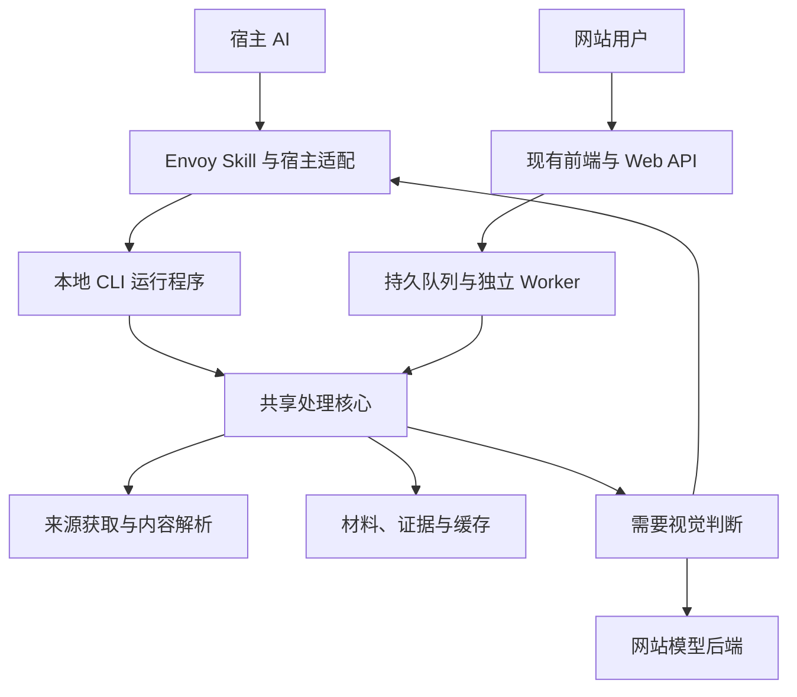
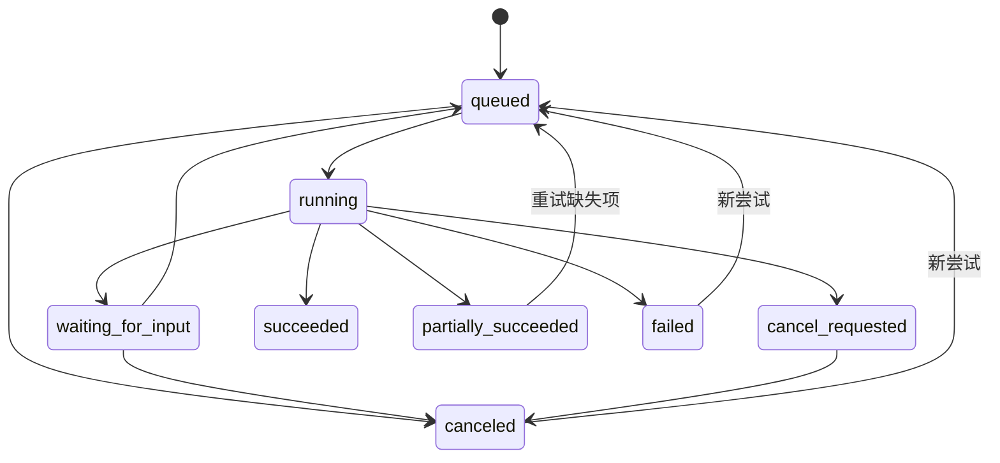

版本：1.0\
制定日期：2026-10-18\
代码基线：regrevia/Envoy 的 dev 分支，fb582660072bfe04c86ddb67b1810a61a3dcbd4b，提交时间 2026-10-18 13:37:36（Asia/Shanghai）。\
文档用途：产品定版、架构约束、任务拆分和发布验收，可直接作为开发 Agent 的实施依据。

本文件中的新接口、安装命令、运行包和验收数字均为待实施的设计要求。第 3 节单独说明已经核实的代码基础。当前没有发布本文描述的 Envoy Skill 安装器，也没有用新架构完成性能实测。

实施状态以 [Agent Link Reader 执行状态](../architecture/agent-link-reader-status.md) 为准。本文保留为用户批准的产品与架构基线；状态页区分设计目标、当前工作树实现、已验证行为和未实现事项。

# 1 产品定版

**Envoy 是面向 AI Agent 的通用链接读取与材料处理引擎。安装后，用户给出链接和当前任务，Envoy 获取、提取、定位并压缩必要材料，宿主 AI 使用这些材料完成用户要求。**

主要入口是可一键安装的 Envoy Skill。现有前端保留为独立 Envoy 网站，服务长任务、并行任务、批量长视频处理和文件导出。两者共享处理核心。

## 1.1 必须遵守的产品约束

| 编号 | 最终决定 | 开发含义 |
| - | - | - |
| P01 | 所有内容链接进入同一个读取入口 | 根据来源、实际响应和任务选择路径；平台适配器不能成为唯一入口 |
| P02 | 公众号图文、普通网页、PDF、图片、音频和视频属于主能力范围 | 首个正式 Skill 版本必须有跨模态闭环，不能继续只接视频 |
| P03 | 安装后默认自动处理当前任务中的链接 | 裸链接默认返回简要内容和可继续读取的位置；已有任务上下文时直接按任务读取 |
| P04 | 默认尽量减少宿主的图片输入 | 正文、字幕、结构提取、OCR、去重与检索优先；必要的视觉细节按区域或片段补读 |
| P05 | 视觉补读保留为正式能力 | 图表关系、界面状态、动作顺序不能仅凭 OCR 推断 |
| P06 | 最终输出由用户和宿主模型决定 | 用户要代码、表格、JSON、方案或其他形式，不需要先为 Envoy 新增输出模板 |
| P07 | 标准安装包含实际运行能力 | 核心、媒体工具、OCR、基础 ASR、浏览器组件及宿主入口在同一次安装中准备就绪 |
| P08 | Skill 默认借用宿主的视觉与推理能力 | 不要求用户再提供第二个视觉模型 API Key；付费内部模型作为可选后端 |
| P09 | 默认不长期保存完整视频 | 支持时按范围读取；必要时临时获取并按生命周期清理 |
| P10 | 网站与 Skill 独立运行 | Skill 不要求网站账号、Web 服务、业务数据库、队列服务或对象存储 |
| P11 | 网站负责持久处理 | 用户关闭页面后，已接收的任务仍由服务端 Worker 执行 |
| P12 | 质量和真实性先于节省数字 | 分别衡量接入成功、任务正确、实际覆盖、费用和耗时；不把漏读算成优化 |

“通用链接”的具体承诺是：对 HTTP/HTTPS 内容链接统一识别、尝试可用路径、返回材料或可行动的结果状态。来源本身的登录、验证码、失效、仅 App 可见和格式限制需要如实返回。读取入口通用，不代表所有网站和所有权限状态都能成功取得内容。

## 1.2 用户使用方式

Skill 的默认交互：

- “这个链接讲什么？”——返回关键内容、来源位置和必要的未覆盖说明。

- “看这个视频，找到部署失败的原因。”——优先定位相关字幕、日志和画面，再回答具体问题。

- “读这篇公众号，把图里的架构改成适合我的项目。”——读取图文关系，必要时补看架构图，宿主结合项目要求完成设计。

- “结合这三个链接，输出我规定的 JSON。”——三个来源共享材料协议，最终 JSON 由宿主生成。

- 只发一个链接——先提供适当长度的内容概览和重要材料；不先要求用户在“总结、提取、转写”等固定模式中选择。

网站的默认交互：

1. 粘贴多条链接、选择播放列表中的项目，或上传本地文件。

2. 写明处理目标，选择处理范围与已经实现的文件格式。

3. 提交后进入任务队列，可以继续提交其他任务。

4. 查看每个来源的进度、可用结果和需要处理的异常。

5. 预览、下载成功项，重试失败项，或追加到已有资料集合。

两个入口的用户需求可以重叠。Skill 也能执行较长任务，但其可靠持续时间取决于宿主会话和执行环境；网站承担离线持续运行、批量调度和长期产物管理的承诺。

# 2 产品边界与成功标准

## 2.1 两个入口的职责

| 维度 | Envoy Skill | 独立网站 |
| - | - | - |
| 主要用户 | 已经在使用 AI Agent 的用户 | 需要批量材料、长任务、团队或持续处理的用户 |
| 任务来源 | 当前会话里的链接和目标 | 表单、批量列表、上传、任务 API |
| 处理运行位置 | 已验证的本地或托管 Agent 执行环境 | 网站的独立 Worker |
| 主要模型 | 当前宿主模型 | 网站配置或用户授权配置的模型服务 |
| 默认反馈 | 当前任务所需的紧凑材料 | 进度、逐项结果和可下载产物 |
| 输出自由度 | 宿主可按任意用户要求组织答案 | 模型写作要求自由，文件容器由已实现的导出器负责 |
| 依赖 | 自包含运行包和宿主能力 | API、Worker、持久存储及站点认证 |
| 共享能力 | 来源获取、解析、证据、索引、预算、缓存、按需读取 | 同左 |

网站的模型配置与 Skill 的宿主模型是两种独立执行方式。网站后台不能依赖一个已经关闭的用户聊天窗口继续执行视觉分析。

## 2.2 核心价值判断

Envoy 的价值需要由三类结果证明：

1. **拿得到。** 原有宿主工具读取不完整的公众号图文、动态页面和媒体来源，能获得更多有效材料。

2. **读得合适。** 根据用户问题选择正文、页面区域和视频时间段，避免重复处理和无关上下文。

3. **交得清楚。** 材料有来源、位置和覆盖记录，宿主可继续追问、核验并自由输出。

公开性能数字只在实际测量后发布。主模型少接收图片是一个指标；完整任务更便宜或更快，必须把 Envoy 自身处理、辅助模型、失败重试和最终回答纳入比较。

# 3 当前 dev 基础与迁移依据

本次确认最新 dev 为 fb58266。它相较此前深入检查的 a3fd170，主要更新 README、视频工作区、样式和部分测试；backend 没有变化。新前端增量已经复核。本文不把旧提交的测试结果作为新提交测试结论。

## 3.1 可以保留和复用的资产

- 视频链接规范化、平台识别、yt-dlp 与浏览器辅助获取逻辑。

- FFmpeg 媒体处理、转写入口、OCR 文本及位置数据、连续重复信息合并。

- 当前 Next.js 前端、FastAPI 后端、任务详情、产物详情与下载能力。

- 现有视频和批量流程中的检查点、证据索引、Markdown/HTML 资源包。

- 已有本地线程池执行与 SQLite/本地存储模式。

- 当前双语界面和视觉风格。

这些资产提供迁移基础；提取时需要纠正与通用读取目标不一致的假设。

## 3.2 必须改造的具体位置

| 当前事实 | 对新目标的影响 | 迁移动作 |
| - | - | - |
| README 仍以视频转主题化 Markdown/HTML 知识库为主 [C1](https://github.com/regrevia/Envoy/blob/fb582660072bfe04c86ddb67b1810a61a3dcbd4b/README.md) | 用户会把产品理解为固定输出的视频工具 | 文档区分通用 Skill 与批处理网站；保留网站的知识库场景 |
| 主流程 video_to_markdown_job 直接读取任务表、创建 Asset 和预处理子任务 [C2](https://github.com/regrevia/Envoy/blob/fb582660072bfe04c86ddb67b1810a61a3dcbd4b/backend/app/workers/jobs.py#L1550-L1706) | CLI 无法直接脱离业务数据库运行 | 提取无应用框架依赖的核心，旧任务入口改为兼容包装 |
| download_video 实际下载本地文件后返回 [C3](https://github.com/regrevia/Envoy/blob/fb582660072bfe04c86ddb67b1810a61a3dcbd4b/backend/app/services/video_source_service.py#L480-L554) | 不能直接宣称当前已经按需远程读取视频 | 把来源解析、流能力探测、范围读取、临时下载拆开 |
| 转写提示和视觉合成仍有中文游戏领域假设 [C4](https://github.com/regrevia/Envoy/blob/fb582660072bfe04c86ddb67b1810a61a3dcbd4b/backend/app/core/config.py#L59-L63)[C5](https://github.com/regrevia/Envoy/blob/fb582660072bfe04c86ddb67b1810a61a3dcbd4b/backend/app/services/vision_service.py) | 通用文章、课程、新闻和技术视频会受到提示偏置 | 默认领域中立，语言自动检测，任务目标由调用方提供 |
| 帧定位存在序号乘配置间隔的推算 [C6](https://github.com/regrevia/Envoy/blob/fb582660072bfe04c86ddb67b1810a61a3dcbd4b/backend/app/workers/jobs.py#L363-L469) | 采样策略改变后证据时间可能错误 | 从实际解码信息记录时间戳，并贯穿切片偏移与音频对齐 |
| 视觉调用存在图数上限和取前若干张的处理 [C5](https://github.com/regrevia/Envoy/blob/fb582660072bfe04c86ddb67b1810a61a3dcbd4b/backend/app/services/vision_service.py) | 请求图片数与实际送入模型的图片数可能不一致 | 能力协商、分批、返回实际交付清单；禁止静默截断 |
| 部分置信度根据 success 状态写固定值 [C6](https://github.com/regrevia/Envoy/blob/fb582660072bfe04c86ddb67b1810a61a3dcbd4b/backend/app/workers/jobs.py#L363-L469) | 形成没有校准依据的“可信度” | 分开记录引擎分数、提取错误、观察来源和不确定项 |
| 本地执行在 API 进程线程池内，启动恢复扫描 pending/running；批量还有内层线程池 [C7](https://github.com/regrevia/Envoy/blob/fb582660072bfe04c86ddb67b1810a61a3dcbd4b/backend/app/services/task_dispatcher.py)[C8](https://github.com/regrevia/Envoy/blob/fb582660072bfe04c86ddb67b1810a61a3dcbd4b/backend/app/workers/jobs.py#L2154-L2284) | 重启恢复、全局并发和公平排队缺乏统一约束 | 网站引入独立 Worker、租约领取和全局资源配额 |
| 批量存在按上限截断来源的路径 [C8](https://github.com/regrevia/Envoy/blob/fb582660072bfe04c86ddb67b1810a61a3dcbd4b/backend/app/workers/jobs.py#L2154-L2284) | 用户可能以为整批已经处理 | 超限显式拒绝或拆批，保存每个提交项的状态 |
| 取消接口可以直接设置 canceled，下载与模型请求未全面贯通取消 [C3](https://github.com/regrevia/Envoy/blob/fb582660072bfe04c86ddb67b1810a61a3dcbd4b/backend/app/services/video_source_service.py#L480-L554)[C9](https://github.com/regrevia/Envoy/blob/fb582660072bfe04c86ddb67b1810a61a3dcbd4b/backend/app/api/v1/tasks.py#L230-L238) | 界面终止不等于后台资源停止 | 增加 cancel_requested，确认子进程和子项停止后进入终态 |
| export_skill_markdown 生成处理后的知识材料 [C10](https://github.com/regrevia/Envoy/blob/fb582660072bfe04c86ddb67b1810a61a3dcbd4b/backend/app/services/train_export_service.py#L1078-L1131) | 不能作为可安装的通用 URL Reader Skill | 保留其材料导出用途；安装型 Skill 采用独立包名和发行入口 |
| 历史版本归档和规范化证据存在资源及字段完整性问题 [C11](https://github.com/regrevia/Envoy/blob/fb582660072bfe04c86ddb67b1810a61a3dcbd4b/backend/app/services/train_export_service.py#L1509-L1944) | 旧版本或来源定位可能不完整 | 不可变版本、完整资源快照、统一证据 schema |
| 最新视频页面仍有未使用的 exportCheckpoint，最近任务主要跳任务详情 [C12](https://github.com/regrevia/Envoy/blob/fb582660072bfe04c86ddb67b1810a61a3dcbd4b/frontend/app/video/page.tsx) | 成功到预览下载的路径没有闭环 | 关联已有产物页面及下载 API |
| 最新主表单仍因当前任务 active 禁止新提交 [C12](https://github.com/regrevia/Envoy/blob/fb582660072bfe04c86ddb67b1810a61a3dcbd4b/frontend/app/video/page.tsx) | 不符合并行长任务网站体验 | 仅对当前提交防重复；排队和额度由服务端控制 |

上表中的“并发改造”不等于当前完全没有并发；“结果入口改造”也不等于当前没有下载功能。应复用现有能力并补齐使用和运行闭环。

# 4 总体架构

## 4.1 架构关系



视觉请求是一种可暂停、可继续的协作动作。共享核心不直接假定自己能够调用当前聊天模型；宿主适配器必须把真实图片资源交给宿主已有的视觉输入能力。

## 4.2 模块边界

| 模块 | 职责 |
| - | - |
| envoy-core | 来源解析、处理策略、正文与媒体提取、材料模型、预算、按需扩展、取消 |
| envoy-cli | 标准输入输出协议、本地配置、检查点、资源租约、进程生命周期 |
| host-bridge | 宿主能力检查、真实图片交付、观察回传、显式/隐式调用适配 |
| source-adapters | 通用 HTTP/HTML、WeChat、视频平台、媒体直链、文档类型适配 |
| providers | OCR、ASR、浏览器、可选视觉与嵌入服务的具体实现 |
| exporters | 从已有材料或文档结构生成文件与资源包 |
| web-api | 认证、任务创建、权限、额度、事件与结果访问 |
| web-worker | 领取任务、运行核心、心跳、恢复、取消、合成与产物发布 |
| frontend | 批量输入、进度、异常处理、预览下载和集合管理 |

“核心不依赖应用框架”允许文件和网络 I/O，但这些能力通过接口注入。导入核心模块时不得连接业务数据库、启动浏览器、加载大模型或创建后台 Worker。

核心最低依赖接口：

```text
SourceResolver     ContentFetcher      DocumentExtractor
MediaReader        OCRProvider         ASRProvider
BrowserProvider    VisionProvider      EvidenceStore
CheckpointStore    BudgetController    CancellationToken
EventSink          ArtifactWriter
```

## 4.3 仓库落点

采用渐进迁移，保留 backend 与 frontend 路径，不先进行大规模目录搬家。

| 目标目录 | 内容 |
| - | - |
| packages/envoy-core | 可独立安装及导入的处理核心 |
| packages/envoy-cli | 命令入口、本地状态与运行管理 |
| integrations/skills/envoy | 轻量 SKILL.md、支持说明和 launcher 元数据 |
| integrations/hosts | Codex、Claude Code 及后续宿主适配 |
| integrations/mcp | 可选 stdio/远程工具适配，复用相同协议 |
| packaging | 安装器、冻结配置、依赖清单和发行构建 |
| schemas | 材料、请求结果、事件、产物 manifest 的版本化 schema |
| backend | 保留的网站 API 和 Worker 适配 |
| frontend | 保留的网站前端 |
| tests/fixtures | 可重现的图文、媒体和异常样本 |
| benchmarks | 数据集清单、基线运行、成本和质量评估 |
| docs | 产品、开发、支持矩阵、协议和安装文档 |

依赖方向必须单向：应用与适配器依赖核心；核心不得反向导入 backend.app、FastAPI 路由或 ORM 模型。开发验收时，在没有网站配置的独立环境中导入并运行核心。

# 5 技术选型与依赖策略

## 5.1 首版实现决定

| 能力 | 首版选择 | 取舍 |
| - | - | - |
| 核心语言 | Python，发布构建固定一套经过验证的解释器版本 | 复用当前处理代码；不重写整个项目 |
| 数据契约 | 类型模型与 JSON Schema，版本化校验 | 关键状态不继续使用任意字典传递 |
| HTTP 获取 | 独立 HTTP 客户端，统一重定向、限额和凭据边界 | 各适配器不能绕开预算和访问策略 |
| HTML 正文 | Trafilatura 提取候选正文，lxml 保留原 DOM 结构和图文关联 | 不能只使用丢失图片位置的纯文本输出 |
| PDF | pypdfium2/PDFium 获取文本位置和渲染区域；复杂表格走专门提取或视觉核验 | 先使用文本层，再对扫描页与局部图像 OCR |
| 常见 Office 文件 | DOCX/PPTX/XLSX 以文档结构解析，记录段落、幻灯片、工作表及单元格位置 | 旧二进制格式单列支持状态，不默认捆绑完整 Office |
| OCR | RapidOCR + ONNX Runtime CPU，中英模型随标准安装固定 | 现有 Paddle/Tesseract 路径可保留为增强后端 |
| 基础 ASR | whisper.cpp 独立 CPU 程序 + 多语 small-q5_1 + VAD 模型 | 标准安装直接支持无字幕内容；大模型/GPU 后端可选 |
| 视频来源 | 复用 yt-dlp，固定匹配的 yt-dlp-ejs 与 JavaScript runtime；拆为解析和获取两层 | 运行包备齐实际来源解析依赖 |
| 音视频处理 | 随包 FFmpeg/ffprobe，记录真实时间信息 | 统一子进程、取消、流量和临时资源控制 |
| 动态页面 | Playwright + 匹配版本的受管理 Chromium | 已授权宿主浏览器可优先复用；登录态不自动迁移 |
| 本地索引 | SQLite 与全文索引，增加中文术语切分或字符 n-gram 预处理 | 首次读取不强制建立向量库或调用嵌入模型 |
| 语义检索 | 可选嵌入/重排 provider | 由基准证明必要后启用，并计入费用 |
| Skill 发行 | 用户级安装器 + PyInstaller onedir 运行包 + 原生能力组件 | 不要求用户先装 Python、Node 或媒体开发环境 |
| 网站 | 保留 Next.js/FastAPI；独立 Worker；现有关系数据库 | 首个网站版本不强制更换数据库或引入完整分布式设施 |

Trafilatura 官方支持正文提取、表格、图片与链接保留选项；这些功能只是提取基础，Envoy 仍需建立自己的块顺序和关系结构。[R1](https://trafilatura.readthedocs.io/en/latest/corefunctions.html) PDFium 的文本与渲染 API 可作为按页、按区域读取基础。[R2](https://pypdfium2.readthedocs.io/en/stable/python_api.html)

RapidOCR 新版需要明确包含推理引擎；发行包不能只收集 Python 包而遗漏 ONNX Runtime 和模型。[R3](https://github.com/RapidAI/RapidOCRDocs/blob/main/docs/install_usage/rapidocr/install.md) whisper.cpp 的跨平台 CPU 路径适合独立管理原生进程和模型，但具体准确率、速度和设备要求需要 Envoy 实测。[R4](https://github.com/ggml-org/whisper.cpp)

## 5.2 依赖分层

标准安装一次准备齐核心、媒体、OCR、基础 ASR、浏览器和宿主适配。运行时只加载实际需要的模块。

增强组件可包括大型 ASR、GPU 加速、专业文档解析、语义检索或外部视觉模型。增加组件不能改变核心协议和已有材料 ID 的语义。

对于短文章，默认路径应只是获取、解析和返回。不要因为安装包中存在 OCR、ASR 或索引组件，就强制对每条链接启动全部能力。

# 6 通用链接识别与获取

## 6.1 统一入口

用户 URL 与任务进入一次 read 调用。核心内部完成轻量探测和首批读取，不要求宿主先调用 probe 再调用 read 才获得正文。

来源处理步骤：

1. 规范化分享文本、短链接及已识别的平台编号；保留原始输入与最终来源的关系。

2. 校验协议、重定向和访问策略，获取实际响应类型。

3. 结合 Content-Type、文件特征、HTML 元数据、嵌入资源和站点适配结果分类。

4. 优先使用最低成本且能完成目标的读取路径。

5. 提取失败或材料不足时，在预算内升级到浏览器、OCR、媒体处理或视觉补读。

6. 返回材料、实际覆盖、剩余问题及可继续操作。

不能只根据 URL 后缀判断内容。也不能把 HTTP 200、网页标题存在或某个第三方接口 success=true 直接当成正文读取成功。

## 6.2 适配器分工

| 适配器 | 负责的事情 |
| - | - |
| GenericWebAdapter | 静态 HTML、正文、表格、代码块、相邻图片、通用动态回退 |
| WeChatArticleAdapter | 公众号正文容器、延迟图片、图注、内嵌内容和访问状态 |
| VideoPlatformAdapter | 元数据、可用字幕、媒体流与来源定位、必要的会话接入 |
| DirectMediaAdapter | MP4/WebM/HLS 等直链探测、范围读取和格式回退 |
| PDFAdapter | 文本层、页码、图像、区域和 OCR |
| ImageAdapter | 原图信息、OCR、局部裁剪和视觉请求 |
| AudioAdapter | 字幕/转写、时间轴和非语音缺口 |
| OfficeAdapter | 常见文档结构与可提取资源 |

站点适配器处理访问和结构差异，业务内容理解交给任务上下文和宿主模型。不要为“游戏、金融、教程、新闻”各写一套抓取流程。

未知站点仍进入 GenericWebAdapter。宿主可以在可用工具、预算和授权范围内选择不同的展开、定位、截图和跟随链接动作；不能由不受信任的网页内容自行创建无限循环或扩大访问范围。

## 6.3 范围默认值

- 默认处理当前资源及其中必要的内嵌材料。

- 默认不递归抓全站、不自动处理整个创作者主页。

- 播放列表/主页返回列表与范围信息；当前任务明确要求整批处理时才展开所需项目。

- 跟随相关链接由任务决定，受来源数量、深度、域与总预算约束。

- 重定向属于当前资源解析，不等于授权递归抓取新内容。

- 本地文件通过单独的显式文件输入读取，不能让任意网页中的 file 路径变成文件读取指令。

## 6.4 访问异常

必须区分 auth_required、challenge_required、source_unavailable、unsupported_source、missing_capability、network_error 和 empty_content。

遇到正常登录或验证码处理时，使用用户已授权的宿主浏览器接口，或 Envoy 专用会话进行可见接管。完成后保存可恢复检查点。只有确实需要新的登录操作、权限或范围决定时才中断；同一授权不反复索要。

# 7 图文与文档读取

## 7.1 首先保留结构，再选择给模型多少内容

原始材料结构包括标题、段落、列表、代码、表格、图像、图注、链接、顺序和父子关系。Envoy 的紧凑返回是原始结构的一种视图，不能成为唯一保存形式。

正文在当前响应预算内能完整返回时，直接返回原文与必要标记。较长内容返回目录、关键段落和可以继续获取的位置；摘要不能替代可回取的原文。

禁止为了更短而随意删除数值、单位、条件、否定词、异常情况和表格脚注。对重复段落可以合并展示，但必须保留出现位置。

## 7.2 微信公众号图文作为首版重点样本

专用适配流程：

1. 提取文章标题、作者、可见发布时间、正文范围及来源 URL。

2. 解析正文与延迟加载图片，修复相对路径，识别图注和附近解释。

3. 保留图片与相邻段落的顺序关系，不把全文图片统一丢到末尾。

4. 对任务相关的文字图、截图和表格图片运行 OCR，记录原图尺寸、文字区域与引擎结果。

5. 检索时将命中段落与相关图注、图片 OCR、后续限制条件一起返回。

6. 架构图连线、曲线走势、分组含义或排版有歧义时发起局部视觉请求。

7. 保留未检查的图片或区域，支持后续追问补读。

例如，正文写“生产环境建议分离”，配图有 A、B 两个服务及箭头。OCR 只能确认标签文字时，不得据此写出依赖方向。需要保留图像位置并交由真实视觉输入核验。

图文关系的依据应标注为 DOM、布局或模型推断。图片被省略时，可以省略像素进入模型的开销，但不能省略“仍有相关图片尚未检查”这一事实。

## 7.3 图片处理顺序

| 内容 | 优先路径 | 需要视觉补读的情况 |
| - | - | - |
| 文字截图、长图文章 | 版面切分、OCR、顺序恢复、重复合并 | 字符不清、代码符号、跨栏顺序有歧义 |
| HTML 表格 | 直接解析表头、单元格、合并与注释 | 图像表格或复杂布局无法可靠恢复 |
| 图表、架构图 | 提取已有图注、标签、坐标和文字 | 箭头、曲线、空间分组、图形语义属于任务核心 |
| 照片、产品外观、场景 | 检查任务是否需要真实视觉 | 需要判断对象、外观、场景细节时直接选择相关区域 |
| 动图、操作录屏 | 时间段或连续帧 | 单帧不足以解释动作顺序或状态变化 |

不是所有图片都必须先跑一次完整 OCR。对于明显依赖外观的任务，先做 OCR 再重新看图可能增加耗时。路由需要以完成问题所需的信息为准。

## 7.4 PDF 与 Office

- 有文本层的 PDF：提取文字和位置，保留页码；扫描页按需渲染与 OCR。

- 页内图表：保留与文本、图注的关系，按区域提供补读资源。

- 坐标必须声明单位、原点、页面尺寸和旋转；内部可统一为归一化左上原点坐标，同时保留原始变换。

- 表格保留表头、单位、脚注与合并关系。无法可靠还原时返回区域和缺口。

- DOCX 保留段落、标题、表格与图片关系；PPTX 保留幻灯片号；XLSX 保留工作表及单元格范围。

- 不执行文档宏。未实现的旧格式和复杂图表呈现返回明确状态，使用后续转换适配器扩展。

- 同一个文档的第二个问题应能读取此前未返回的页、表格或图片，不重做整份材料。

# 8 视频与音频处理

## 8.1 按问题决定读取深度

| 用户问题 | 读取策略 |
| - | - |
| “大概讲什么” | 元数据、章节、字幕或初步转写，配合代表性画面；报告采样范围 |
| “找到某一步/某个报错” | 字幕、OCR 与时间索引检索，扩大命中时间段，必要时连续帧核验 |
| “解释 12:10–13:20” | 直接定位目标时间范围，结合音频与画面 |
| “整理完整操作步骤” | 逐段覆盖任务范围，重点保留状态变化、例外和遗漏检查 |
| “完整转写并生成 MD” | 获取目标音轨、分段转写、校验完整时间范围，再导出 |
| “批量处理数十个长视频” | 网站持久任务、共享资源配额、分项检查点和逐项产物 |

最后三类任务可能需要较大计算量。完整性要求与预算冲突时，应保留已完成材料和剩余范围；不能自动缩成少量关键帧后仍宣称已经完整处理。

## 8.2 获取策略

来源解析返回可用字幕、音轨、媒体流、时长、格式、访问条件和有效期，不直接强制下载完整 MP4。

具体路径：

1. 有可用字幕时先读取字幕，并标记人工字幕、自动字幕及其语言。

2. 需要画面时，探测流是否支持所需范围访问和可靠 seek。

3. 支持的来源按目标区间读取；有独立音轨时，ASR 可以只获取音频。

4. 不支持可靠范围访问时，临时获取必要资源或完整文件，并记录真实下载量。

5. 处理结束按策略释放原媒体；保留可追问的文本、索引和少量必要资源。

FFmpeg 的远程读取能力依赖协议、服务器、封装、索引和关键帧；指定时间范围不保证只下载对应秒数的字节。[R5](https://ffmpeg.org/ffmpeg-protocols.html) 产品用语应是“按需获取，默认不长期保留原视频”，不要承诺任意视频零下载、零缓存或固定带宽节省。

## 8.3 采样与索引

首版采用可解释的启发式策略：

- 元数据/章节/字幕提供粗定位。

- 低密度抽样建立初始画面索引。

- 相邻帧差异、OCR 文本变化和已知目标区间决定加密采样。

- 检索命中的画面与前后连续帧组成局部证据。

- 全片逐帧或场景检测只在任务要求或成本比较支持时执行。

为检测场景变化而完整解码整段视频，也是一项实际成本。不能把“最终只返回十帧”说成“整个处理过程只看了十帧”。

每一帧记录实际时间戳、来源视频、解码参数、原图尺寸及裁剪变换。时间戳来自真实帧信息；切片偏移、变帧率、VAD 去静音映射必须计入。

对于“整个视频从未出现 X”等否定性结论，稀疏采样不构成完整支持。需要扩大检查范围，或明确说明能够支持的结论范围。

## 8.4 ASR 与语音覆盖

标准安装使用多语模型，不默认固定中文，也不默认翻译。已有字幕质量足够时无需重复 ASR。

没有字幕时，通过 FFmpeg 抽取适当音频，再由本地 ASR 分段处理。VAD 可以减少无语音计算，但必须保留到原时间轴的映射。

至少保留：

- 原始 ASR 文本、起止时间和模型版本；

- 原字幕与 ASR 的来源区别；

- 无语音、识别不清和执行失败的区别；

- 任务相关的数字、专名、版本号疑点；

- 后续修订与原识别结果的关系。

宿主做语言修订时追加修订记录，不覆盖原始转写。CPU 本地转写的速度按设备和材料实测，长内容允许先返回部分材料和可继续状态。

# 9 材料与证据协议

## 9.1 接口形态

核心采用“材料句柄 + 增量读取 + 视觉补读请求”。一次摘要不是唯一产物。

| CLI 能力 | 输入 | 输出 |
| - | - | - |
| read | 来源、当前目标、范围、预算、宿主能力 | session_id、material_id、首批材料、覆盖信息 |
| expand | 同一会话、材料或位置、查询/区域/时间段 | 增量原文、表格、OCR、字幕或视觉请求 |
| observe | action_id、实际交付资源、宿主观察 | 关联原材料的派生观察，可用于后续读取 |
| status | session_id | 处理状态、剩余范围、预算与资源有效期 |
| release | session_id 或材料租约 | 释放结果与仍被引用的资源 |
| doctor | 宿主及安装配置 | 运行与宿主能力检查结果 |

视觉补读统一通过 expand 的请求参数或核心返回的 needs 发起，不要求用户学习另一套工具。

拟议 CLI 调用方式：

```text
envoy read --request-json -
envoy expand --request-json -
envoy observe --request-json -
envoy status --session <session_id> --json
envoy release --session <session_id> --json
```

请求 JSON 通过标准输入传入，避免把完整用户任务、Cookie 或敏感链接放进进程命令行。stdout 只输出协议结果，stderr 用于经过脱敏的运行日志。

短操作在当前进程完成。长操作优先使用宿主提供的异步执行句柄；缺少该能力时，由 launcher 启动任务专属的本地后台进程，记录 PID、运行版本、检查点和资源租约，前台返回 session_id。后台进程在任务结束、预算耗尽或租约失效后退出；需要宿主观察时提交检查点并暂停。status 查询状态，observe 或 expand 继续同一任务。CLI 不通过反复终止 FFmpeg/ASR 来制造时间片，也不要求常驻 HTTP 服务。

默认本地处理承诺限于当前机器与宿主允许的执行生命周期；机器休眠、关机或宿主终止进程后的恢复依赖检查点。需要离线持续完成的任务使用独立网站。

## 9.2 标识与不可变性

| 标识 | 语义 |
| - | - |
| protocol_version | 请求/响应协议，如 envoy.read/1 |
| request_id | 一次调用 |
| idempotency_key | 一次逻辑操作的重试键；同键不同参数应拒绝 |
| session_id | 当前用户任务的执行与累计预算账本 |
| material_id | 一个材料句柄 |
| source_revision | 不可变来源快照版本 |
| block_id | 当前快照中的稳定材料块 |
| resource_id | 图片、音频或其他可读取资源 |
| action_id | 一次需要宿主执行的动作 |
| attempt_id | 实际处理尝试，网站和重试诊断复用 |

新用户问题可以复用 material_id 和原始提取结果，但拥有自己的任务目标及预算会话。同一任务的 expand 不能自动重置预算。

同一 URL 内容变化后生成新的 source_revision，旧 block_id 不得静默指向新网页内容。带身份的来源按访问范围隔离，不能将不同用户的私有页面视作一个快照。

source_revision 是 Envoy 的快照版本，不要求先取得整个原文件的哈希。来源记录 version_strength（strong、weak、unverified）、观察时间和实际可用的 ETag/平台版本依据；已获取页面、分段和图片各自保存内容摘要。弱版本或未验证来源采用较短复用期。展开时发现来源变化，生成新版本并关联旧材料，不能追加成旧快照中的原内容。图文资源异步获取时记录各自版本与时间，不能假定它们必然来自同一瞬间。

## 9.3 请求示例

以下为合成示例，不代表读取过某一篇实际文章。

```json
{
  "protocol_version": "envoy.read/1",
  "request_id": "req_01",
  "idempotency_key": "op_01",
  "source": {
    "url": "https://example.com/article"
  },
  "goal": "解释文章的系统架构，并保留图中组件关系与限制条件",
  "scope": {
    "kind": "current_resource",
    "follow_links": false
  },
  "budget": {
    "max_response_chars": 12000,
    "max_total_response_chars": 48000,
    "max_visual_inputs": 12,
    "max_visual_pixels_per_input": 2097152,
    "max_total_visual_pixels": 16777216,
    "max_visual_clip_seconds": 15,
    "max_total_visual_clip_seconds": 45,
    "max_download_bytes": 268435456,
    "max_work_seconds": 180,
    "max_expansion_rounds": 3,
    "max_optional_model_calls": 0
  },
  "retention": {
    "raw_media": "ephemeral",
    "derived_ttl_seconds": 86400
  },
  "host_capabilities": {
    "tool_execution": true,
    "image_input": "local_file",
    "video_input": "none",
    "usage_reporting": "unavailable"
  }
}
```

goal 是开放的自然语言任务，不是封闭任务枚举。宿主只传读取所需目标、关键词、范围和约束，不把整段聊天历史重复传进核心。

max_work_seconds 指 Envoy 当前任务允许使用的累计处理墙钟时间，暂停等待用户/宿主的时间单独记录。并发阶段的 CPU 时间另行累计。字符限制以完整响应序列化后的 Unicode 字符计数为准，包含元数据；有匹配 tokenizer 时可以增加真实 token 上限。

## 9.4 材料块

每个块包含稳定 ID、类型、内容、来源、定位和关系。正式 schema 根据 kind 使用有类型的联合结构。

```json
{
  "id": "blk_ocr_03",
  "kind": "ocr",
  "content": {
    "text": "API 服务 任务队列 Worker",
    "language": "zh"
  },
  "origin": "ocr",
  "locator": {
    "type": "image_region",
    "resource_id": "img_03",
    "coordinate_system": "normalized_top_left",
    "bbox": [0.08, 0.12, 0.91, 0.84],
    "source_width_px": 1600,
    "source_height_px": 900
  },
  "parent_id": "section_02",
  "order": 7,
  "relations": [
    {
      "type": "derived_from",
      "target_id": "img_03",
      "basis": "extraction"
    }
  ],
  "quality": {
    "engine": "configured-ocr-engine",
    "engine_score": null,
    "unresolved": ["箭头方向尚未核验"]
  }
}
```

origin 至少区分 source_text、subtitle、asr、ocr、table_parse、host_visual 和 model_summary。模型总结与推断不能覆盖来源原文。

定位规则：

| 来源 | 必需定位 |
| - | - |
| 网页 | 来源快照 + 块 ID，可附选择器和原文引用定位 |
| PDF | 页码 + 区域 + 明确坐标体系及旋转 |
| 图片 | 原图资源 ID + 尺寸 + 裁剪或变换 |
| 视频 | 原视频时间戳 + 帧/片段 ID + 起止范围 |
| 音频 | 原始时间轴起止点 + 字幕或 ASR 来源 |
| Office | 文档内部结构位置，如段落、幻灯片、工作表及单元格 |

## 9.5 执行状态与读取结果分开

执行状态：

- running

- waiting_for_host

- completed

- failed

- canceled

读取结果：

- ready：当前请求所需的材料已经可用。

- partial：有可用材料，但当前请求仍有缺口。

- needs_host：需要宿主视觉等动作后继续。

- blocked：访问或能力条件阻止继续，携带具体原因。

- empty：成功读取到确实为空的内容。

completed 表示一次操作结束，并不意味着整篇材料或整段视频全部被理解。completed + blocked 可用于“访问判定已完成但登录阻断”；failed 用于未能完成该操作的执行故障。

摘要请求基于明确采样可以完成并返回 ready；它的 coverage 仍应写明采样。完整转写请求只完成前半段应返回 partial。

会话持有累计预算、活动 request_id 和待完成 action 集合；status(session_id) 返回这些操作及其状态。一次 read/expand 完成不关闭会话，在剩余预算内仍可展开。observe 是新的调用，但通过 action_id 关联并恢复原操作：以 action_id、输入资源摘要及观察内容摘要原子消费动作；完全相同的重复提交返回原结果，内容不同的重复提交拒绝并要求显式修订。多个视觉动作按依赖推进，独立动作可在同一预算内并行，不重复追加观察或扣费。

## 9.6 视觉协作返回示例

```json
{
  "protocol_version": "envoy.read/1",
  "request_id": "req_01",
  "session_id": "ses_01",
  "material_id": "mat_01",
  "source_revision": "rev_01",
  "execution_state": "waiting_for_host",
  "result": "needs_host",
  "blocks": [
    {
      "id": "blk_ocr_03",
      "kind": "ocr",
      "content": {"text": "API 服务 任务队列 Worker", "language": "zh"},
      "origin": "ocr",
      "locator": {
        "type": "image_region",
        "resource_id": "img_03",
        "coordinate_system": "normalized_top_left",
        "bbox": [0.08, 0.12, 0.91, 0.84],
        "source_width_px": 1600,
        "source_height_px": 900
      },
      "parent_id": "section_02",
      "order": 7,
      "relations": [
        {"type": "derived_from", "target_id": "img_03", "basis": "extraction"}
      ],
      "quality": {"engine_score": null, "unresolved": ["连线方向未核验"]}
    }
  ],
  "resources": [
    {
      "resource_id": "img_03_crop_01",
      "mime_type": "image/png",
      "delivery": {
        "type": "local_file",
        "path": "/runtime/envoy/ses_01/img_03_crop_01.png"
      },
      "width_px": 1328,
      "height_px": 648,
      "sha256": "0000000000000000000000000000000000000000000000000000000000000000",
      "source_resource_id": "img_03",
      "transform": {
        "type": "crop",
        "coordinate_system": "normalized_top_left",
        "bbox": [0.08, 0.12, 0.91, 0.84]
      },
      "lease_id": "lease_01",
      "delivery_evidence": "generated_only",
      "expires_at": "2026-10-19T06:00:00Z"
    }
  ],
  "coverage": {
    "text": {
      "extracted_blocks": 28,
      "returned_blocks": 1,
      "extraction": "complete"
    },
    "images": {
      "discovered": 3,
      "ocr_processed": 2,
      "delivered_to_vision": 0,
      "observed_by_vision": 0
    },
    "unresolved": ["架构图的连线方向"]
  },
  "needs": [
    {
      "action_id": "act_01",
      "type": "inspect_visual",
      "purpose": "核验 API、队列与 Worker 的连接方向",
      "resource_ids": ["img_03_crop_01"],
      "source_block_ids": ["blk_ocr_03"],
      "reason": "OCR 只有组件名称，无法确定箭头关系",
      "max_resources": 1,
      "resume_token": "opaque_resume_token"
    }
  ],
  "usage": {
    "host_model": {"status": "unknown"},
    "auxiliary_models": [],
    "local": {"download_bytes": 154320}
  },
  "expires_at": "2026-10-19T06:00:00Z"
}
```

上述路径、哈希和内容均为合成示例。正式返回的 resources 提供当前宿主实际可读的绝对路径、受支持的 MCP URI 或其他已授权交付方式，包含 MIME、尺寸/时长、内容摘要、来源变换及租约；未返回资源映射时必须有可用的资源获取操作。只给不透明 resource_id 不足以完成读图。

原图到裁剪图的映射保存在资源记录中。宿主通过受支持的工具获取并真正读取像素；observe 提交实际 resource_id 与同一内容摘要、观察内容和证据关联，防止资源错配。若宿主已足以直接完成答案，不强制把整段最终回答再传回 Envoy。

## 9.7 实际覆盖与输出约束

coverage 按模态分别记录：

- 全部已识别正文块、实际返回块及截断位置。

- 可用字幕范围、实际转写范围和当前返回范围。

- 处理过 OCR 的图片与真实帧时间戳。

- 生成的图片、实际交付给视觉输入的图片、得到视觉观察的图片。

- 视频采样方法、已检查区间与尚未检查的间隔。

- 获取失败、提取失败与任务主动省略的部分。

完整清单可以放在本地材料清单中按游标获取，紧凑返回只放与当前判断相关的统计、位置和缺口。不要为了“可追溯”把每帧日志全部塞回模型。

资源生成、返回图片路径、工具交付图片、宿主完成观察是四个不同事件。只有路径不能证明模型已经看图。交付和观察记录要标明证据来自适配器事件、宿主回传还是尚未验证；没有可核实的交付事件时保留 unknown/unverified，不能把一段 observe 文字当成独立验证。各后端图片上限变化时以实际交付资源为准。

正式 JSON Schema 必须定义类型、枚举、大小限制、分页、缺省值、错误码及版本协商。未知可选字段可忽略；不兼容主版本显式报错，不静默猜测。

# 10 宿主 Skill 与模型协作

## 10.1 Skill 保持简短、可按需加载

主 SKILL.md 只包含：

1. 何时使用 Envoy：当前任务要求读取、理解、比较或处理链接内容。

2. 如何调用当前运行程序。

3. 如何根据 ready/partial/needs_host/blocked 继续。

4. 如何补看真实图片并保留来源。

5. 如何把材料用于用户的任意最终输出。

6. 如何遵守任务预算、访问范围和释放策略。

详细平台文档、调试指南、完整 schema 和长例子分到 references，调用时按需读取。目标是减少每次启动 Skill 的上下文成本，不能把开发说明书直接放进主 Skill。

触发描述示意：

> 在用户要求读取、理解、提取、比较或处理 URL 内容时使用 Envoy，包含网页图文、公众号、文档、图片、音视频。结合当前任务优先获取紧凑材料；必要时按位置扩展或进行视觉补读。仅引用 URL、编辑 URL 字符串或明确要求不访问时不触发。

## 10.2 隐式触发与显式入口

官方宿主根据 Skill 元数据选择隐式调用，并提供显式调用方式。Codex 用户目录为 \~/.agents/skills；Claude Code 用户目录为 \~/.claude/skills。宿主分发和云端加载方式存在差异，需要独立适配。[R6](https://learn.chatgpt.com/docs/build-skills)[R7](https://code.claude.com/docs/en/skills)

首版提供并测试：

- Codex：$envoy 显式入口和链接任务隐式触发。

- Claude Code：个人 Skill 的 /envoy；插件发行的命令以实际命名空间为准。

- 后续宿主：通过相同协议接入，并公布测试过的版本和能力。

仅靠 description 不能保证每条含 URL 的消息百分之百调用 Envoy。显式入口是稳定回退；宿主确有支持的 hooks/路由机制时再增加强触发，并遵守当前环境能力。

## 10.3 宿主能力条件

推荐安装目标同时具备：

- 视觉输入能力；

- 工具或脚本执行能力；

- 允许的网络访问；

- 对 Envoy 输出资源的实际读取能力。

CLI 不能凭模型名证明这些条件成立。安装握手需要实际文本读取、工具执行及仅能通过图像识别的样张任务；缺失或不可验证时分别显示 missing 或 unverified。

当前 ChatGPT 插件可用于多种界面，但桌面专用插件和云端运行有不同限制；账号安装 Skill 不等于把本机二进制部署到云端。[R8](https://learn.chatgpt.com/docs/plugins) 因此首版宣传“支持经过验证的宿主环境”，不使用“任意 GPT 对话窗口安装后都能本地执行”的表述。

## 10.4 可选模型与原生工具协作

默认由宿主模型判断任务，核心执行材料处理，不增加一个携带全量聊天历史的内部规划 Agent。

当宿主原生工具已能准确、低成本完成某种读取时，适配器可以采用原生路径并纳入统一证据和费用记录。Envoy 的路由允许选择更好的底层工具。

复杂图表或大量画面可使用用户主动配置的内部视觉后端。其调用必须记录 provider、model、输入资源、费用和结果来源；不能为了减少宿主图片数而隐藏一轮甚至多轮外部视觉成本。

# 11 预算、缓存与资源生命周期

## 11.1 预算作用于整个任务

预算包括：

- 返回宿主的正文、结构数据和工具元数据；

- 图片数量、处理尺寸和连续片段范围；

- 下载字节、转写范围、处理墙钟时间与并发；

- 辅助模型调用次数、可选费用上限；

- 自动展开轮数。

每次 expand 从同一个累计账本扣除，失败和重试同样计量。任务开始前根据用户需求选择预算，明确全量处理的请求可以采用更高的已授权预算；增加执行范围不能隐式突破用户设置的上限。

max_visual_inputs 按累计实际视觉交付次数计数，同一缓存图片再次送进模型也计数，唯一资源数另记。每张图、整次任务的像素总量及原生视频片段时长同时受限；拼图按实际像素和所含时间范围记录，不能用一个文件规避限制。示例默认每次图像输入最多 2,097,152 像素、任务累计 16,777,216 像素，片段单次 15 秒、累计 45 秒；这些是可配置设计值。宿主不支持原生视频时使用受控连续帧，并按实际图像输入计量。

max_optional_model_calls 仅限制额外的生成式视觉/语言、嵌入、重排和可选云端调用。标准本地 OCR/ASR 由本地时长与计算预算约束，默认可以使用，并单独记录模型处理用量。

下面是首次交互的可调设计默认值，不是性能承诺：

| 参数 | 初始值 |
| - | - |
| 单次返回字符 | 12,000，包含元数据 |
| 当前任务累计返回字符 | 48,000 |
| 自动扩展回合 | 3 |
| 单次视觉交付 | 最多 4 个资源，并服从宿主实际限制 |
| 当前任务视觉资源 | 最多 12 个 |
| 当前任务获取量 | 256 MiB |
| Envoy 累计处理时间 | 180 秒，等待宿主时间另计 |
| 单次 CLI 执行时间片 | 20 秒左右，可返回进度后续跑 |
| 默认可选模型调用 | 0，标准本地 OCR/ASR 不属于该额度 |

这些默认值应由首批样本校准，并通过配置覆盖。网页任务不应因为存在 256 MiB 上限就主动下载到上限；全量长视频任务也不应被这些交互默认值静默截断。

预算不足时返回 partial、剩余范围、已用额度和可继续句柄。总响应额度内必须预留有界控制封装额度，内容阶段不能耗尽它；自定义额度连最小错误/状态封装都无法容纳时，在处理前返回 budget_too_small。状态轮询同样计入返回量，默认最短间隔 5 秒、自动轮询最多 12 次，优先使用宿主异步完成通知；最终控制封装返回后停止自动轮询，避免预算归零后仍持续注入元数据。

下载预算覆盖 HTTP 客户端、浏览器、yt-dlp、FFmpeg 和其子请求。每个后端声明计量来源、停止方式和在途缓冲可能产生的有界超额，不能仅统计落盘文件大小。需要硬限制时，采用可计量的受控获取器/代理或有上限的暂存路径；无法实施的后端返回 budget_enforcement_unavailable，或在允许 best_effort 的显式策略下标明限制强度。不能把仅对普通 HTTP 生效的计数宣称为全链路硬上限。

用户的当前指令和预设策略已覆盖后续执行时直接继续；需要新增费用或处理范围时才请求相应决定。

## 11.2 费用与性能记录

| 记录 | 必须区分 |
| - | - |
| 宿主模型 usage | actual、estimated、unknown；不可见时保留 unknown |
| 内部模型 usage | 按 provider、model、文本/图片/音视频、缓存状态逐项记录 |
| 本地处理 | CPU/GPU 时间、墙钟耗时、峰值内存 |
| 数据获取 | 真实下载字节、请求次数、缓存命中 |
| 资源占用 | 临时磁盘峰值、衍生缓存量、最终产物大小 |
| 质量与覆盖 | 当前请求范围、实际完成范围、失败及未核验内容 |

不同模型的 token 不能直接相加作为统一“节省率”。同模型可比较输入量；跨模型比较应采用完整费用并列出本地计算。宿主账单不可获得时，可以报告工具返回量、视觉资源量和内部已知费用，但总成本结论应标注未知。

图像费用与模型、尺寸及输入方式有关，压低 JPEG 文件字节数不等于按同比例减少视觉 token；图像 detail 的作用也需要按当前模型规则判断。[R9](https://developers.openai.com/api/docs/guides/images-vision)

## 11.3 缓存分层

缓存按阶段纳入规范来源标识、source_revision、访问身份范围、处理器版本、变换参数与读取区间。只有视觉描述、摘要等派生阶段额外绑定模型、提示和任务目标；改变最终写作要求不应失效原始获取、OCR 和字幕提取缓存。版本较弱的来源按第 9.2 节记录并缩短复用期限。

| 缓存 | 用途 | 初始保留策略 |
| - | - | - |
| 原视频或原音频暂存 | 当前提取 | Skill 在任务结束且无活动引用后尽快删除 |
| 页面快照、帧与音频切片 | 视觉补读、追问 | 独立 TTL，默认不超过 24 小时 |
| 正文、OCR、字幕、索引 | 增量读取与复用 | CLI 默认 24 小时，可配置 |
| 视觉观察与任务派生材料 | 避免相同问题重复看图 | 绑定输入摘要、模型、目标和版本 |
| 已发布网站结果 | 用户下载与引用 | 网站默认 30 天，可由站点策略调整 |

网站原始暂存可默认在成功后 24 小时清理，失败/取消后最多保留 72 小时便于恢复；达到用户主动删除、配额或隐私策略时按更严格规则执行。界面应显示实际保留期限。

不得只缓存最终摘要。后续问题可能需要第一次未注入宿主的原文、图片或时间段。

## 11.4 并发、幂等与清理

- 同来源、版本、范围和处理参数使用 singleflight 或操作账本共享已经进行的工作。

- 阶段完成后原子提交输出摘要、文件信息和检查点。

- 源文件、模型或提示版本变化，只失效受影响的阶段。

- 有效资源租约阻止清理正在使用或等待宿主读图的文件。

- 成功、失败、取消、崩溃和下次启动回收都进入同一个生命周期机制。

- 外部模型请求超时可能已经执行，记录 unknown_outcome；支持幂等或查询时优先使用。

- 不支持外部幂等的服务不能承诺 exactly once，也不能无限自动重试。

- 资源过期后返回 expired_resource；需要时重新获取并校验来源版本，不能伪造原资源仍存在。

# 12 一键安装与发行

## 12.1 一键安装的交付定义

**首版主分发路线：官方安装器 + 按平台构建的自包含运行包 + 宿主 Skill 注册。**

用户从发布页选择安装按钮，或运行发布页为当前平台提供的一条命令。安装器完成环境检测、下载、校验、运行自检和宿主接入。正常用户不需要自行安装 Python、Node、pip、FFmpeg、OCR 框架或编译 ASR。

PyInstaller 可以连同 Python 解释器和依赖交付，用户无需额外安装 Python；不同系统需要分别构建。选择 onedir 可避免每次运行重新解包大量依赖。[R10](https://pyinstaller.org/en/stable/operating-mode.html)

## 标准运行包

| 组件 | 默认交付内容 |
| - | - |
| 核心与 CLI | 固定解释器、Python 依赖、schema 和默认配置 |
| 媒体工具 | FFmpeg、ffprobe |
| 视频解析 | yt-dlp、匹配的 yt-dlp-ejs、经过验证的 JavaScript runtime |
| OCR | RapidOCR、ONNX Runtime CPU、中英模型 |
| ASR | whisper.cpp CPU 程序、多语 small-q5_1、VAD 模型 |
| 浏览器 | Playwright driver 与匹配版本的完整 Chromium |
| 宿主入口 | SKILL.md、必要说明、稳定 launcher 和能力握手 |
| 发布元数据 | 版本、哈希、签名、协议兼容范围、依赖与模型来源、许可信息 |

标准安装在完成前备齐模型。第一次读取不再临时提示用户手动下载 OCR 或 ASR。

yt-dlp 的当前 YouTube 获取需要匹配的 EJS 脚本与 JavaScript runtime。可复用经过版本和来源解析验收的 Playwright 内置 Node，通过绝对路径明确指定给 yt-dlp；不符合要求时随包交付固定版本。EJS 脚本也在安装时准备，不依赖首次访问再下载执行组件。[R14](https://github.com/yt-dlp/yt-dlp/wiki/EJS)

只交付与 Playwright 匹配的完整 Chromium，使用 channel="chromium" 的 new headless 模式；不要求同时安装独立 headless-shell。需要用户登录且环境有桌面时，可打开 Envoy 专用可见会话。[R15](https://playwright.dev/python/docs/browsers) 已经明确授权的宿主浏览器接口可以优先使用，不能把“电脑装了 Chrome”当成自动获得登录会话权限。

运行包按需启动组件，不常驻网站或数据库服务。下载量和落盘大小由实际发行清单展示，不在测量前承诺几 MB 或固定几分钟安装完毕。

## 可选配置

- standard：默认推荐，以上基础能力齐备。

- lite：用户显式选择的精简配置，可以省略 ASR/Chromium，但必须展示能力差异。

- enhanced：大模型、GPU、专业文档解析等增强包。

lite 不能被默认安装后再用首次运行补依赖的方式伪装为标准一键可用。

## 12.2 平台支持范围

首个正式 standard 版本以以下目标为发布门槛：

- Windows 11 x64；

- macOS 14 及以上的 Apple Silicon；

- Ubuntu 24.04 x64。

Intel Mac、Windows ARM64、其他 Linux 发行版与架构按同样验收流程逐步增加。只有实际通过发行测试的平台才进入“已支持”矩阵。

当前 Playwright 官方系统要求决定了浏览器组件的兼容边界；Linux 还可能需要 NSS、字体等系统依赖，下载 Chromium 不等于这些依赖已经存在。[R11](https://playwright.dev/python/docs/intro)

默认安装在用户目录。Windows 需要的可再分发运行库随实际发行方式处理；Linux 如缺系统库，在同一次安装流程中明确列出并使用正常系统权限完成。权限受限又无可用宿主浏览器时报告 browser_unavailable，不能标记 standard 完整就绪。

发行 CI 在各目标系统构建并固定依赖，不使用构建机的偶然指令集作为全部 x64 设备的基线。Windows 安装包进行代码签名，macOS 包完成签名与公证；清单签名和平台签名分别验证。发布记录包含实际下载量、落盘大小、启动时间及依赖/模型清单。

不以关闭系统校验、禁用浏览器沙箱或给运行程序全局管理员权限作为标准安装步骤。受管理 Chromium 显式启用 chromium_sandbox，并在普通用户的目标发行环境中验收；不能仅因没有主动添加 --no-sandbox 就假定沙箱已经启用。[R16](https://playwright.dev/python/docs/api/class-browsertype#browser-type-launch-option-chromium-sandbox) 启动受系统策略阻止时返回具体条件或使用被允许的宿主浏览器路径。

## 12.3 安装流程

1. 识别 OS、CPU、系统版本、磁盘空间与已安装宿主。

2. 确定目标宿主和发行版本；只安装选定宿主入口。

3. 获取签名发行清单，校验文件长度、哈希和版本关系。

4. 下载至 staging，支持中断重试；未完整校验不得执行。

5. 解包版本目录，完成必要系统依赖检查。

6. 实际运行正文、FFmpeg、OCR、ASR、浏览器自检。

7. 注册用户级 Skill，用 launcher 的真实绝对路径连接运行程序，不依赖当前终端 PATH 已刷新。

8. 使用宿主适配器进行显式调用、文本和真实读图握手。

9. 原子启用版本和宿主入口，显示能力结果；确有需要时说明重新加载宿主。

10. 给出直接输入链接的使用示例。

安装自检与宿主握手必须使用候选新版本的显式路径或候选事务 ID，返回待安装版本和协议版本。全部通过后再提交激活事务；中断或失败恢复上一可用入口。不能让稳定 launcher 仍调用旧版本，却把旧版本成功算成新版本通过。

多宿主环境可以在安装器中一次选择；无人值守安装通过参数固定，不能反复交互。已有权限继续使用，安装器不得覆盖宿主整份配置或修改全部工具的审批策略。

拟议管理接口如下，尚未发布：

```text
envoy-setup --host codex --profile standard
envoy-setup --host claude-code --profile standard
envoy doctor --host codex --json
envoy update --version <release>
envoy rollback
envoy uninstall
```

发布前生成与真实文件名、签名包和版本对应的安装命令。当前不把未发布的下载 URL 写成可执行教程。

## 12.4 安装就绪状态

| 状态 | 含义 |
| - | - |
| files_installed | 文件已经放到正确位置 |
| runtime_ready | 声明的提取、OCR、ASR、浏览器和媒体能力实际通过自检 |
| host_ready | 宿主发现 Skill、能够执行工具并读取真实视觉资源 |
| degraded | 某项声明能力缺失，其他路径仍可用 |
| vision_unverified | 无法证明当前宿主能够接收并理解图片 |

对用户显示“可以直接使用”的标准是当前配置的 runtime_ready 与 host_ready 均成立。检查 SKILL.md 存在或 envoy --version 成功不足以通过。

## 12.5 其他分发入口

npx skills add 或宿主插件市场可以分发轻量 Skill 和 launcher。它们复用同一官方运行包安装及 doctor 流程，不维护另一套依赖逻辑。

Skills CLI 的主要职责是获取并向宿主安装 Skill 目录；它不能自动证明 Envoy 所需媒体程序和模型已经就绪。[R12](https://github.com/vercel-labs/skills) 只安装入口时应报告 runtime_missing，并引导同一安装流程完成准备。

后续需要云端 ChatGPT 等环境时，可发布调用托管运行时的插件/MCP 适配。它属于独立部署目标：安装到账号、权限、网络和执行环境均应验收，不能默认复用用户电脑的二进制路径。

## 12.6 升级、回滚和卸载

采用不可变版本目录、稳定 launcher、当前版本指针和独立用户数据目录。

- 正在执行的任务固定运行版本，升级不改变其依赖。

- 新版本下载、自检通过后再切换；失败保留当前可用版本。

- 默认保留当前与上一可用版本。

- Skill、CLI 和核心按 protocol_version 协商，主版本不兼容时明确提示。

- OCR/ASR 模型、Playwright/Chromium 按发行清单一起固定与回滚。

- 运行数据和配置不覆盖进版本目录；迁移要支持失败恢复。

- 卸载仅删除安装清单记录的文件与精确宿主配置项。

- 用户主动导出的结果独立保留；缓存和登录会话清理提供明确选项。

- Windows 不依赖具有特殊权限要求的目录软链接作为唯一版本切换方案。

# 13 独立网站的长任务与批量架构

## 13.1 复用现有应用

保留现有 Next.js 前端和 FastAPI 后端。现有单视频、主页作品、本地视频、任务详情和产物页面逐步接入新协议，不先重做整个界面。

网站运行依赖可以分两档：

| 部署 | 最小组成 |
| - | - |
| 单机自用 | API + 独立 Worker + SQLite + 本地文件 |
| 对外网站 | API + 独立 Worker + 关系数据库 + 用户认证 + 持久产物存储 |

首版可以继续使用已有 MySQL。持久队列先以数据库任务表与租约实现；Redis/Celery、对象存储和多机能力通过适配器增加。它们不进入 Skill 的强制依赖。

HTTP 请求只提交、查询或操作任务；视频处理在 Worker 中执行。

## 13.2 数据实体

| 实体 | 必要内容 |
| - | - |
| Job | 用户目标、提交者、输出要求、总体预算、范围、状态 |
| JobItem | 单个 URL/文件、来源版本、处理顺序、独立状态 |
| Attempt | 每次执行版本、配置快照、用量、错误和时间 |
| StageCheckpoint | 已完成阶段、依赖、文件摘要和恢复位置 |
| ResourceLease | 活动资源、所有者、有效期和引用 |
| Artifact | 格式、大小、摘要、来源范围、访问与保留期限 |
| Event | 有序进度、状态变更、错误和需要用户处理的动作 |
| ModelProfile | 能力、非敏感配置、拥有者和 secret_ref |
| CollectionVersion | 不可变资料集合版本及追加关系 |

Job、材料、产物、模型配置和凭据均有明确用户或工作区归属。已有数据迁移时保留旧 ID，增加兼容映射和旧产物访问路径。

## 13.3 任务状态



阶段使用独立字段：

```text
resolve / fetch / extract / index / inspect / compose / export
```

waiting_for_input 用于登录恢复、预算或用户提供材料等必要条件。它不持续占用昂贵处理槽位。

succeeded 要求完成用户请求范围、必要处理和产物发布。partially_succeeded 允许访问成功项，并明确缺失项。任务主动限定只读一个片段时，完成该片段可以 succeeded，不能因为没处理整片而一律记部分成功。

重试创建新的 Attempt，保留原尝试的事件和用量。已取消项也可以创建新尝试，重新检查当前授权、累计预算和检查点；原 Attempt 保持 canceled，不恢复为 running。父任务状态由子项和最终合成要求聚合。

## 13.4 领取任务与并发

数据库领取至少记录 worker_id、attempt_id、lease_expires_at、heartbeat_at、ready_at 和递增 fencing_token。

使用事务或比较更新原子领取。租约过期后可以重新入队；旧 Worker 不得继续发布结果，提交检查点和产物时验证仍拥有当前 fencing_token。

调度规则：

1. 批量父任务只记录与聚合，不占处理线程等待所有子项。

2. 每个来源是可独立恢复的队列项，取消嵌套线程池的无约束扩张。

3. 下载、FFmpeg、OCR、ASR、视觉服务分别设全局资源槽位。

4. 每用户并发、全站并发与供应商限流同时生效，多 Worker 使用共享约束。

5. 长任务分段检查点化，采用公平轮转或保留交互任务容量。

6. 创建时保存全部提交项；超限显式拒绝或拆批，不能丢弃尾部链接。

7. 供应商暂时失败和网络抖动有限重试；登录失效、资源下架和不支持格式进入明确状态。

8. API 进程重启不重复派发仍有有效租约的任务。

全局配额应作用于实际资源操作。例如两项视频任务各开启八个 ASR 子进程，不能因为“任务数为二”就算符合并发限制。

## 13.5 取消、恢复和断点

取消已排队项可以直接终止；运行中先进入 cancel_requested。

下载、浏览器、FFmpeg、OCR、ASR 和模型请求统一接收取消信号。停止新增工作，终止可以终止的子进程，回收任务拥有的资源。已发送到外部供应商的请求可能仍产生费用，记录已知状态。

受任务拥有的活动工作停止后再标记 canceled。多个任务共享的只读缓存和独立工作不能因其中一个用户取消而被删除。

检查点复用条件：

- 来源版本、处理参数与处理器版本兼容；

- 必需文件仍存在且摘要一致；

- 前置阶段有效；

- 模型和提示配置快照符合当前阶段要求。

原媒体已被清理而文本阶段有效时，允许从文本继续；真正需要补看画面时再获取对应材料。Worker 异常结束后，从最近有效检查点恢复已完成阶段，避免重复昂贵处理。

## 13.6 服务端模型

网站配置自己的模型后端，可由站点提供，也可使用用户授权的配置。

- 每个任务固定 ModelProfile 快照。

- 密钥由 secret_ref 引用，不放进任务 JSON、日志或导出材料。

- 用户修改配置只影响之后任务；重跑时创建新尝试并记录变化。

- 能力记录实际图片输入形式、图片上限、上下文、原生视频能力、超时和用量报告。

- 长任务所需的视觉、合成和可选 ASR 服务由 Worker 使用，无需用户保持聊天窗口在线。

现有“密钥仅加密保存在本机”的文案应按部署区分。独立网站需要显示真实的服务端保存位置与使用方式。

## 13.7 API 与前端闭环

拟议网站 API：

| 接口 | 作用 |
| - | - |
| POST /api/v2/jobs | 带幂等键提交一项或多项来源，返回已接收任务 |
| GET /api/v2/jobs | 按当前身份、状态和时间查询 |
| GET /api/v2/jobs/{id} | 范围、子项、覆盖、当前阶段、结果 |
| GET /api/v2/jobs/{id}/events | 增量事件，可使用 SSE |
| POST /api/v2/jobs/{id}/cancel | 请求取消 |
| POST /api/v2/jobs/{id}/retry | 重试指定失败、缺失或已取消项 |
| POST /api/v2/jobs/{id}/resume | 在授权或输入补齐后恢复 |
| GET /api/v2/artifacts/{id} | 已授权产物详情 |
| GET /api/v2/artifacts/{id}/download | 已授权文件下载 |
| POST /api/v2/collections/{id}/append | 带版本条件追加结果 |

v1 API 用兼容适配逐步迁移，不一次删除已有入口。兼容入口与 v2 使用相同的身份、所有权和网络出口检查，不能保留可绕过隔离的旧全局查询或操作接口。

前端优先完成六件事：

1. 一个长任务运行时仍能创建另一个任务；当前正在查看的任务不影响新提交。

2. 批量来源逐项列出，展示排队、运行、完成和异常数量。

3. 成功任务直接关联已有产物预览与下载。

4. 支持取消、仅重试失败项、继续等待输入的任务。

5. 按实际阶段、来源数或处理范围显示进度；无法可靠估计时不显示虚假的精确剩余时间。

6. 展示当前用户需要决定的预算、处理范围、保存期限和模型配置，详细日志按需展开。

现有双语与样式继续使用。语言切换等界面行为不得改变用户选中的工作区或当前任务。

# 14 文件导出与资料集合

## 14.1 内部材料与最终文件分开

Skill 的材料协议服务模型读取，网站的导出协议服务文件交付。它们共享原文、证据和资源，但不能互相限制输出。

网站用户可输入任意内容要求，模型据此生成正文或文档结构。导出器只负责实际文件格式、资源复制、链接和校验，不重新抓取来源或重复 OCR/ASR。

首版稳定导出：

| 格式 | 内容 |
| - | - |
| Markdown | 可读正文、标题结构、来源链接和必要资源引用 |
| HTML | 同样内容的预览，带可检查的图片和时间定位 |
| JSON / JSONL | 结构化材料、证据和元数据 |
| ZIP | 完整正文、资源与 manifest |
| SRT / VTT | 用户要求转写时生成的对齐字幕 |

DOCX、PDF 等作为导出扩展增加，不要求重做来源处理。网站只显示实际完成并校验过的格式。Skill 用户要求自定义 JSON、代码或其他文本时，宿主直接生成即可。

## 14.2 不可变版本

产物写入顺序：

1. 在新 staging 目录生成正文及资源。

2. 校验文件、引用、格式、来源与实际覆盖。

3. 生成 manifest：schema 版本、来源版本、处理版本、文件摘要和资源清单。

4. 发布为不可变版本。

5. 更新“最新版本”指针。

第一版即位于独立版本目录，每一版包含完整需要的正文、图片和证据。根入口只作为最新版本视图；历史链接不能指向以后会覆盖的根文件。

追加集合时使用版本锁或乐观并发条件，避免两个追加任务覆盖彼此结果。遇到互相矛盾的来源，保留来源与差异，标记待核验；不能仅写空 conflicts 数组便声称完成冲突处理。

发布结果引用的图片必须复制或持久引用到产物资源集合。清理任务临时目录后，已发布的 HTML/MD 和历史版本仍应完整可用。

## 14.3 内容合成成本

长任务按有来源的材料块进行分段合成，最终阶段接收必要的结构与证据索引。避免每追加一个视频就把此前全部原文重新输入模型。

已有材料足以重新导出时，仅执行格式渲染。写作目标改变才重新合成相应内容；来源没有变化时不重复下载、OCR 和转写。

# 15 授权、数据隔离与可观测性

## 15.1 授权边界

本地 Skill 使用用户当前授予的网络、工具和文件权限。日常读取流程在已有范围内自动进行；新账号登录、额外付费模型、上传到远程服务和扩大处理范围需要服从用户已经设置的策略。

网页、字幕、OCR 和文档中的指令作为来源数据处理，不能修改宿主系统指令、提升权限或要求发送密钥。模型可以自由解释内容，工具动作仍经过核心的来源、预算和权限检查。

远程网站任务移交必须有已配置的目标及授权。私有材料不能因为本地任务较长就自动上传到公共 Envoy 网站。

## 15.2 对外网站的基础要求

- 所有任务、材料、产物、集合和模型配置按用户或工作区隔离。

- 列表、详情、下载、修改、重试和取消接口统一检查所有权。

- 私有来源缓存不能跨访问身份暴露。

- Cookie、认证头、签名 URL 的敏感部分和 API Key 不进入普通日志或模型材料。

- 服务器获取 URL 与模型 Base URL 执行网络出口策略，检查内部地址、元数据地址和重定向后的目的地；内网自部署通过明确配置开放所需范围。

- 渲染 HTML 进行内容清理；文件下载使用产物 ID 与授权，不能接受任意服务器路径。

- 外部程序用参数数组执行，来源文本不拼接成 shell 命令。

- 上传、解析和解压限制文件大小、页面/条目数、展开大小及处理时间。

这些要求在公开给多人使用前完成。单机的全局模型配置和全局列表查询不能直接承担多用户服务。

## 15.3 诊断信息

每次处理保留 trace_id、来源版本、阶段、耗时、处理器版本、预算使用、缓存状态与错误分类。日志默认不记录全文、原图或凭据。

日常用户看到具体可行动信息，例如“需要重新登录”“扫描页的两处数字尚未辨认”“已完成 17/20 个来源”。详细调用记录、采样位置和模型用量供调试展开。

本地诊断默认留在本地。产品改进用的匿名统计应单独设置，不能默默上传原始内容。

# 16 开发阶段与任务拆分

## 16.1 实施顺序

**先完成通用核心和一条真实 Skill 链路，再把网站的持久任务接上同一核心。** 开发过程中现有网站持续可运行。

| 里程碑 | 交付 | 完成标准 |
| - | - | - |
| M0 基线冻结 | 当前行为清单、兼容入口、协议草案、固定样本 | 当前能力与拟议能力分清；迁移有可比较输入输出 |
| M1 独立核心 | 材料模型、获取接口、预算、生命周期、CLI | 无网站、无业务数据库仍能读取简单网页并继续展开 |
| M2 通用内容 | 公众号图文、PDF、图片、Office、音视频统一材料 | 所有主模态有真实提取与来源定位，不只返回文件名 |
| M3 视频按需与视觉桥接 | 字幕优先、范围读取、ASR、真实时间、宿主补读 | 局部视频问题与图文视觉问题完整跑通 |
| M4 一键 Skill beta | 标准运行包、安装器、两个首批宿主适配 | 干净目标系统安装后完成文本、OCR、ASR与真实视觉样张 |
| M5 网站 beta | 持久队列、独立 Worker、并行、取消恢复、产物闭环和身份隔离 | 长任务期间可继续提交；异常恢复与部分成功可用；公开多人 beta 前 D16 通过 |
| M6 独立稳定发布 | 各产品的故障与隔离验证、性能/质量报告和发行验证 | Skill 与网站分别按第 18.3 节门槛发布，支持矩阵符合实际能力 |

M2 的网页文档工作与 M3 的媒体工作可在同一协议上并行。M4 的安装打包应从 M1 开始做小样验证，不能等全部功能完成后才发现无法分发。

M5 可以在核心稳定后开始，不要求等待所有网站扩展格式完成。发布 Skill 不以对外网站上线为前置条件。

## 16.2 可分配的开发任务

| 任务 | 内容 | 依赖 | 可验证结果 |
| - | - | - | - |
| D01 | 冻结样本、当前入口和代码基线 | 无 | 样本来源、权限、任务和预期证据可重现 |
| D02 | 材料/请求/事件 schema 与版本协商 | D01 | 合法与异常示例有明确判定 |
| D03 | 核心包、依赖注入、CLI 和本地状态 | D02 | 关闭网站后端仍能独立执行 |
| D04 | HTTP、正文、图文关系、通用动态回退 | D03 | 短文章一次返回；长文章可增量取原文 |
| D05 | 公众号适配与中英 OCR | D04 | 图注、正文顺序、长图、图后限制条件不丢失 |
| D06 | PDF、图片、常见 Office 适配 | D03 | 页/区域/结构位置准确，扫描内容可补读 |
| D07 | 媒体解析与获取解耦 | D03 | 同时支持可范围读取和临时下载回退 |
| D08 | 字幕、ASR、VAD、真实时间与自适应索引 | D07 | 无字幕任务可用，字幕/画面定位一致 |
| D09 | 视觉请求和两个宿主桥接 | D02、D05 或 D08 | 模型能识别只存在于像素的细节 |
| D10 | 累计预算、用量账本、缓存、租约与清理 | D03，贯穿 D04–D09 | 追问不重做已完成阶段，额度不会被展开重置 |
| D11 | 标准运行包、安装器、doctor、升级回滚 | D03 原型后持续推进 | 干净机器一键可用，断网自检通过 |
| D12 | 网站 Job/Item/Attempt 与持久 Worker | D02、D03 | 重启不重复领取，有租约和检查点 |
| D13 | 全局配额、公平排队、取消与恢复 | D12、D10 | 多来源并发受控，取消后资源确实停止 |
| D14 | 现有前端任务与产物闭环 | D12 | 运行中仍可提交，成功项可直接下载 |
| D15 | 导出器、完整证据与不可变集合版本 | D02、D12 | 所有历史版本独立可打开，追加不覆盖 |
| D16 | 网站身份、凭据与数据隔离 | D12 | 两个用户不能访问或操作彼此资源 |
| D17 | 固定基准、真实宿主端到端与发行矩阵 | D01 后持续推进 | 质量、覆盖、费用、耗时和安装证据齐备 |

每个任务交付实现、必要的错误语义、直接相关验证和文档。将测试集中于来源正确、视觉交付、资源生命周期、故障恢复及用户目标，不靠复制实现的文本断言证明行为正确。

## 16.3 估算与人员组织

在两名熟悉仓库的开发者、有人负责真实材料验收的假设下，可用以下范围做排期起点：

- 第 1–2 周：M0/M1，核心和协议，安装最小原型。

- 第 2–4 周：M2/M3，图文文档与媒体并行推进，视觉桥接。

- 第 4–6 周：M4，跨平台依赖、宿主闭环与安装 beta。

- 第 5–8 周：M5，网站 Worker、队列、批量和界面闭环。

- 第 6–8 周：Skill 按自身门槛独立进入稳定发布。

- 第 8–10 周：网站完成故障、隔离、性能质量与发行验证。

这是工程估算，不是已确认工期。站点访问波动、媒体样本差异和平台打包可能改变排期。单人开发按同样依赖顺序推进，优先保证 M4；网站上线独立排期。

# 17 验收与基准

## 17.1 固定样本集

建立约 60 个来源、至少 120 个明确任务的首批样本集。数量用于发现回归和校准策略，不作为普遍准确率的统计保证。

| 来源 | 初始数量 | 必测内容 |
| - | -: | - |
| 网页图文 | 16 | 8 篇公众号、4 篇普通网页、4 个动态页面 |
| 视频 | 20 | B 站、抖音、YouTube、媒体直链；含有字幕、无字幕和纯视觉内容 |
| PDF | 8 | 文本、扫描、表格、多栏、图文混排 |
| 图片 | 6 | 文字长图、代码、图表、架构关系与视觉细节 |
| 音频 | 4 | 中文、英文、混合术语和静音/噪音 |
| Office | 6 | DOCX、PPTX、XLSX 的结构与嵌入图片 |
| 合计 | 60 | 每个来源至少两类任务，覆盖概览、定位和自由输出 |

按来源拆分开发样本和未参与调优的验证样本，例如 42/18。源 URL、快照或授权 fixture、任务、参考证据、访问条件与模型配置都记录版本。站点登录失效或下架单列访问变化，不能偷偷删除失败样本。

增加独立异常组：登录墙、验证码、空内容、过期链接、不支持格式、被取消、预算不足、进程异常和来源更新。

## 17.2 三条比较基线

1. 相同宿主模型的默认原生读取能力。

2. 相同宿主与合理工具组合：正文提取、字幕、按问题截图等。

3. 相同宿主安装 Envoy 的自动处理。

固定模型、任务、来源快照、访问身份与预算。原生支持视频的模型应使用其正常能力，不能只拿“把所有原尺寸帧全部塞入模型”作对照。现有原生视频能力也在发展，基准需要记录使用的真实版本与输入路径。[R13](https://ai.google.dev/gemini-api/docs/video-understanding)

分别运行：

- 冷缓存首次读取；

- 暖缓存下的新问题；

- 相同问题重复请求；

- 双方都能读取的样本；

- Envoy 新增可访问能力的样本。

原生无法读取的来源用于衡量接入收益，不直接形成相同质量下的节省百分比。

## 17.3 质量与真实性门槛

| 项目 | v1 验收要求 |
| - | - |
| 有效来源接入 | 固定验证集目标至少 95%；按来源类别和访问条件公开分母与失败项 |
| 来源真实性 | 异常组全部返回明确状态；不能以标题、空页面或固定摘要伪装读取 |
| 证据定位 | 关键任务中的页码、时间、图像区域和原文引用可以实际回查 |
| 图文关系 | 图注、相邻限制条件、数值与单位不被无提示丢弃 |
| 视觉真实性 | 至少一组只有像素包含答案的样本，经宿主真实读图后正确完成 |
| 画音差异 | 字幕和画面冲突时能补读并区分来源 |
| 完整性 | 完整转写/完整步骤的任务不能用稀疏采样冒充完成 |
| 自由输出 | 自定义 JSON、代码、表格和 Mermaid 无需新增核心导出器即可完成 |
| 增量读取 | 第二问涉及首次未返回的材料时能够取得原文或资源 |
| 用量真实性 | 隐藏辅助调用、未知宿主用量和未知付费结果不能记成零 |

用户问题的参考答案按关键事实、关键遗漏、证据支持和格式要求评估。采用固定评分规则并抽样人工复核；不能只用输出相似度证明理解正确。

## 17.4 效率门槛与发布数字

预先选定两个核心任务组，例如“公众号文字与图文问答”和“长视频局部问答”，在同质量门槛下比较较强的基线。

将以下设为内部效率发布门槛：至少两个预先登记的任务组，完整模型费用或端到端耗时的中位数改善达到 20%；同时报告 p95、冷暖缓存差异、失败率和本地计算。这个数值是开发门槛，尚未测得，不能作为现有产品宣传。

同时观察：

- 宿主实际输入或工具返回量；

- 实际视觉资源数量及处理尺寸；

- 总模型费用，包括输入、输出、缓存、辅助服务和失败重试；

- 首次可用材料时间和完整任务时间；

- 网络字节、磁盘峰值和本地 CPU/GPU 开销；

- 相同问题与新问题的缓存复用。

宿主 usage 不可见时，该宿主不发布“全链路费用降低”结论，可发布有依据的耗时、返回量和图像数量指标。需要完整费用比较时，使用能报告 usage 的等价受控运行环境，并明确与真实宿主体验的区别。

如果某类短文本原生读取已经足够快，Envoy 可以直接使用低成本路径；性能报告应保留该类结果，不能只挑收益高的样本。

## 17.5 一键安装验收

在每个声明支持的干净系统上完成：

1. 没有 Python、Node、FFmpeg 和开发工具也能完成 standard 安装。

2. 安装后断网运行中英文 OCR 样张，确认引擎和模型齐备。

3. 断网运行中文、英文、混合术语和无语音音频，确认真实 ASR 权重与 VAD 齐备；静音不生成凭空的转写。

4. 用内置视频实际解码、抽帧并核对时间戳。

5. 实际以普通用户启动带沙箱浏览器，读取包含延迟图片的测试页；检查 JavaScript runtime 和 EJS 组件，并单独执行代表源在线解析。运行自检与来源临时不可达分开诊断。

6. 宿主发现 Skill，显式调用可用，链接任务隐式触发可用。

7. 宿主通过真正的图片输入辨认仅存在于像素的标记。

8. 中文和空格安装路径、重复安装、中断下载、校验失败、更新失败、回滚和卸载重装可恢复。

9. 缺系统依赖、缺宿主权限或视觉能力不可验证时，准确显示降级状态。

10. 安装器只修改 Envoy 相关文件与精确宿主配置，已有其他 Skill 保持可用。

隐式触发增加正负例：正文阅读、视频问答应触发；仅改写 URL 字符串、引用日志中的 URL、用户明确不访问时不触发。统计召回与误触发，不以一次演示代替兼容性验证。

## 17.6 网站验收

- 已有长任务运行时能够创建新任务，满额时排队。

- 批量部分失败，成功项仍可下载，原提交项无静默丢失。

- 杀死 Worker 后任务从有效检查点恢复。

- API 重启不会重复派发仍有有效租约的任务。

- 失去租约的旧 Worker 无法发布结果。

- 取消后停止新工作和可终止的子进程，最终状态与实际资源一致。

- 两个用户不能读取、下载、取消或复用彼此的私有材料。

- 两次并发追加保留各自结果，不覆盖历史版本。

- 清理临时资源后，每个已发布历史版本的图片、证据和下载仍完整。

- CLI 与网站对同一快照产生兼容材料结构。

- 改输出格式只触发必要渲染，不重复媒体提取。

# 18 发布顺序与长期维护

## 18.1 发布顺序

1. 合并核心协议、材料提取和旧入口兼容包装。

2. 发布内部 CLI 与两种宿主的端到端预览。

3. 完成 standard 安装包，发布 Skill beta 和真实支持矩阵。

4. Skill 通过自身验收后独立发布稳定版。

5. 网站作为并行发布线，在持久 Worker、结果闭环和隔离通过后发布 beta，再按网站门槛上线；网站发布时间不阻塞稳定 Skill。

6. 根据实际任务数据扩展平台适配、增强模型和文件格式。

Skill、核心协议和网站分别有版本；发行清单声明兼容范围。源码 dev 用于开发，稳定发行从通过验收的版本构建，不让用户的一键安装直接跟随浮动 dev。

## 18.2 优先投入的方向

后续投入依据失败与收益数据排序：

- 国内站点访问和图文结构的稳定性；

- 按问题定位的材料选择；

- 小文字、图表和动作顺序的补读质量；

- 缓存、续跑和累计预算；

- 干净环境安装及宿主差异；

- 长任务批量吞吐和结果完整性。

不把“增加更多提示词模板”当成能力覆盖。新增站点若只改变获取结构，加入适配器；新增用户输出需求优先由宿主完成；新增文件容器交给导出器。

## 18.3 完成定义

**稳定 Skill 的发布门槛：** 标准安装器在真实目标系统通过验收；两个首批宿主完成显式、隐式和真实视觉读取；跨模态材料、定位、增量读取、覆盖、预算、缓存和清理通过；具备质量效率报告、升级回滚、卸载及支持文档。Skill 独立运行和发布，不以网站完成为条件。

**独立网站的上线门槛：** 共用核心协议兼容；持久队列、并行、取消恢复、身份隔离、产物访问、资源保留和不可变历史版本通过网站验收；明确站点模型、配额、保留期限和运维方式。

**整个项目的完成定义：** 两个入口分别满足以上门槛，保留独立版本和部署方式，共享经过验证的材料及处理核心。

这套完成定义把产品主张落到用户能够验证的行为：装好后给 AI 一个链接，得到完成当前任务所需的材料与结果；需要持续批量处理时，使用同一核心驱动的独立网站。

# 19 来源与核查说明

源码结论依据固定 dev 快照；官方资料核查日期为 2026-10-18。第三方组件版本、宿主入口及系统要求在实际发行时再次锁定并验收。

## 19.1 源码依据

- [C1](https://github.com/regrevia/Envoy/blob/fb582660072bfe04c86ddb67b1810a61a3dcbd4b/README.md) README 与当前视频产品范围。

- [C2](https://github.com/regrevia/Envoy/blob/fb582660072bfe04c86ddb67b1810a61a3dcbd4b/backend/app/workers/jobs.py#L1550-L1706) 主视频流程与业务数据库耦合。

- [C3](https://github.com/regrevia/Envoy/blob/fb582660072bfe04c86ddb67b1810a61a3dcbd4b/backend/app/services/video_source_service.py#L480-L554) 当前视频解析与实际下载。

- [C4](https://github.com/regrevia/Envoy/blob/fb582660072bfe04c86ddb67b1810a61a3dcbd4b/backend/app/core/config.py#L59-L63) 默认转写语言与领域提示。

- [C5](https://github.com/regrevia/Envoy/blob/fb582660072bfe04c86ddb67b1810a61a3dcbd4b/backend/app/services/vision_service.py) 视觉调用、图片数量与内容合成。

- [C6](https://github.com/regrevia/Envoy/blob/fb582660072bfe04c86ddb67b1810a61a3dcbd4b/backend/app/workers/jobs.py#L363-L469) 时间位置与固定置信度写入。

- [C7](https://github.com/regrevia/Envoy/blob/fb582660072bfe04c86ddb67b1810a61a3dcbd4b/backend/app/services/task_dispatcher.py) 本地线程池与启动恢复。

- [C8](https://github.com/regrevia/Envoy/blob/fb582660072bfe04c86ddb67b1810a61a3dcbd4b/backend/app/workers/jobs.py#L2154-L2284) 批量处理和子任务并发。

- [C9](https://github.com/regrevia/Envoy/blob/fb582660072bfe04c86ddb67b1810a61a3dcbd4b/backend/app/api/v1/tasks.py#L230-L238) 任务取消接口。

- [C10](https://github.com/regrevia/Envoy/blob/fb582660072bfe04c86ddb67b1810a61a3dcbd4b/backend/app/services/train_export_service.py#L1078-L1131) 已有知识材料 Skill 导出。

- [C11](https://github.com/regrevia/Envoy/blob/fb582660072bfe04c86ddb67b1810a61a3dcbd4b/backend/app/services/train_export_service.py#L1509-L1944) 证据规范化、版本资源与根索引。

- [C12](https://github.com/regrevia/Envoy/blob/fb582660072bfe04c86ddb67b1810a61a3dcbd4b/frontend/app/video/page.tsx) 最新视频页面的任务及结果入口。

## 19.2 官方资料

- [R1](https://trafilatura.readthedocs.io/en/latest/corefunctions.html) Trafilatura 正文与结构提取。

- [R2](https://pypdfium2.readthedocs.io/en/stable/python_api.html) pypdfium2 文本定位和渲染 API。

- [R3](https://github.com/RapidAI/RapidOCRDocs/blob/main/docs/install_usage/rapidocr/install.md) RapidOCR 安装、推理引擎与模型。

- [R4](https://github.com/ggml-org/whisper.cpp) whisper.cpp CPU、多平台、模型和 VAD。

- [R5](https://ffmpeg.org/ffmpeg-protocols.html) FFmpeg 协议与时间定位。

- [R6](https://learn.chatgpt.com/docs/build-skills) OpenAI Skill 编写和宿主发现。

- [R7](https://code.claude.com/docs/en/skills) Claude Code Skills。

- [R8](https://learn.chatgpt.com/docs/plugins) ChatGPT/Codex 插件及运行环境边界。

- [R9](https://developers.openai.com/api/docs/guides/images-vision) OpenAI 图像输入与模型计费相关规则。

- [R10](https://pyinstaller.org/en/stable/operating-mode.html) PyInstaller 自包含与 onedir 运行方式。

- [R11](https://playwright.dev/python/docs/intro) Playwright 系统要求与浏览器依赖。

- [R12](https://github.com/vercel-labs/skills) Skills CLI 分发能力。

- [R13](https://ai.google.dev/gemini-api/docs/video-understanding) Gemini 原生视频理解能力与输入路径。

- [R14](https://github.com/yt-dlp/yt-dlp/wiki/EJS) yt-dlp 的 EJS 和 JavaScript runtime 依赖。

- [R15](https://playwright.dev/python/docs/browsers) Playwright 浏览器发行与 new headless 模式。

- [R16](https://playwright.dev/python/docs/api/class-browsertype#browser-type-launch-option-chromium-sandbox) Playwright Chromium 沙箱参数。
